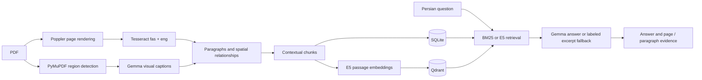

# Persian Document Understanding

A local document question-answering system for Persian scientific PDFs, including embedded English terminology. It combines OCR, page layout, visual-region captions, lexical or semantic retrieval, and Persian answers with page and paragraph evidence.

This is an **applied systems project**. Its contribution is the integration of layout-aware evidence and Persian document QA; it does not train a new foundation model or establish a new state of the art.

[Watch the two-minute app walkthrough](docs/assets/demo.webm) using original synthetic example data.


## What it does

- Ingests PDFs and normalizes Persian OCR text.
- Finds candidate images, tables, and formulas with PDF layout heuristics; Gemma generates short Persian captions.
- Attaches visual captions to spatially related paragraphs and builds contextual chunks.
- Stores documents, chunks, and visual metadata in SQLite, with optional E5 vectors in Qdrant.
- Supports BM25 lexical search and document-filtered semantic search.
- Displays generated answers and their retrieved evidence, including page and paragraph locations. Generation failures are visibly labeled as source-excerpt fallbacks.



## Installation

The supported baseline is **Linux and Python 3.12**. Full captioning and answer generation require an NVIDIA CUDA GPU. The validation environment uses an RTX 2060 with 6 GiB VRAM; memory use depends on document regions and context length. Consult [validation notes](docs/VALIDATION.md) for measured checks and remaining limitations.

```bash
sudo apt-get install python3.12-venv tesseract-ocr tesseract-ocr-fas tesseract-ocr-eng poppler-utils
python3.12 -m venv .venv
source .venv/bin/activate
python -m pip install --upgrade pip

# GPU build used by the validation environment:
python -m pip install torch==2.11.0 torchvision==0.26.0 --index-url https://download.pytorch.org/whl/cu130
python -m pip install -r requirements.txt
python -m pip check
```

`requirements.txt` pins direct dependencies and applies the Linux/Python 3.12 dependency versions in `constraints.txt`. CUDA constraints do not force a GPU installation when compatible CPU PyTorch wheels are installed first.

Use a compatible NVIDIA driver and a PyTorch build appropriate to your machine. See the [official PyTorch installation selector](https://pytorch.org/get-started/locally/). FP4 inference deliberately does not fall back to loading the full Gemma model on CPU.

For CPU unit tests, install PyTorch and torchvision from `https://download.pytorch.org/whl/cpu` instead, then install the same requirements. Unit tests do not download or load model weights, and do not require a Qdrant server.

### Models

Model weights are downloaded separately and are never committed to Git. [models.lock.json](models.lock.json) pins the upstream repositories and revisions:

| Use | Upstream model | Loading |
|---|---|---|
| Visual captions and Persian answers | `google/gemma-3-4b-it` | Local weights, FP4, CUDA |
| Semantic retrieval | `intfloat/multilingual-e5-small` | Mean pooling, normalized 384-dimensional vectors |

Review and accept the [Gemma terms](https://ai.google.dev/gemma/terms) on its [model page](https://huggingface.co/google/gemma-3-4b-it), then authenticate locally. Never commit access tokens.

```bash
hf auth login
python -m scripts.download_models --dry-run
python -m scripts.download_models
```

The downloader omits duplicate PyTorch `.bin`, ONNX, and OpenVINO weights and writes a revision receipt beside the downloaded files. The application loads local files only; it does not silently fetch weights at startup.

To reuse existing downloads without copying or downloading them again, export `VGEN_MODEL_PATH` and `EMBEDDING_MODEL_PATH` before starting the app. In a release folder beside the original project's `models` directory, use `VGEN_MODEL_PATH=../models/vgen` and `EMBEDDING_MODEL_PATH=../models/embedding`.

### Qdrant and startup

Install Docker with the Compose plugin, then:

```bash
./scripts/start_qdrant.sh
python -m scripts.check_qdrant
python -m diagnostics
python -m streamlit run streamlit_app.py --server.address 127.0.0.1
```

Compose pins Qdrant 1.17.1 by image digest and binds its ports to localhost. Its storage is under `app_data/qdrant`. A missing Qdrant server leaves lexical ingestion usable and records semantic indexing as failed with an explanatory message. Re-ingesting the same file retries indexing.

The interface opens before loading model weights and explains missing dependencies. Disable **Generate visual captions** for OCR-only ingestion. Answers use source excerpts when generation is unavailable, with an explicit warning; this is not CPU Gemma inference.

## Try an original example

```bash
python -m examples.make_demo_pdf --output app_data/demo.pdf
```

Upload the resulting PDF, ingest it, select it in QA, and ask:

> مقدار AUC روش آلفا چقدر است؟
>
> What is the AUC of method Alpha?

The source states **0.91**. Try asking for the price of the hardware as an unsupported question. All values in this demonstration document are invented and labeled as such. They are not project evaluation results.

See [the demo guide](docs/DEMO.md) for the walkthrough and recording procedure.

## Evaluation

The pilot contains **30 source-checked Persian questions** about the two existing papers: 20 text, six visual-associated, and four unanswerable questions. The Persian paper and the English paper are reported separately; the latter tests cross-language retrieval. Independent human review of the gold annotations and answer/citation grades remains necessary.

The runner compares BM25 and E5 with visual captions on and off. It produces page-level Hit@5 and MRR@5, latency, fallback rates, memory measurements, raw outputs, and an unfilled human grading sheet. It does not invent accuracy or treat missing grades as failures.

The completed pilot made **120 question attempts**. Retrieval scores below use the 26 answerable questions per condition:

| Retrieval | Captions | Page Hit@5 | Page MRR@5 |
|---|---|---:|---:|
| BM25 | Off | 0.769 | 0.649 |
| BM25 | On | 0.692 | 0.571 |
| E5 | Off | 0.846 | 0.633 |
| E5 | On | 0.885 | 0.579 |

Captions raised E5 Hit@5 by one question while lowering its reciprocal rank; BM25's aggregate Hit@5 fell by two questions. Effects varied by document. Answer support, citation correctness and unsupported-question abstention still require independent human grading.

See the [aggregate results](validation/pilot-summary.csv), [question-level retrieval metadata](validation/pilot-retrieval.jsonl), and [runtime record](validation/pilot-runtime.json). Evaluation PDFs and their source passages remain outside the public snapshot. Timings include generation and cold-loading effects and support descriptive observations rather than a controlled speed comparison.

```bash
python -m evaluation.run --corpus-dir /path/to/authorized/pdfs --output-dir evaluation_runs/pilot
python -m evaluation.review evaluation_runs/pilot
```

The PDFs are not redistributed here. See [the evaluation protocol](docs/EVALUATION.md) for acquisition, exact input hashes, metric definitions, human review, and corpus limitations. The runner uses separate SQLite and in-memory Qdrant stores; it does not purge the application's data or contact the application's Qdrant server.

## Tests and validation

```bash
HF_HUB_OFFLINE=1 TRANSFORMERS_OFFLINE=1 CUDA_VISIBLE_DEVICES='' python -m unittest discover -s tests -v
python -m scripts.check_release

# Run separately with CUDA, model files, Tesseract and Poppler:
python -m scripts.gpu_smoke --output evaluation_runs/gpu-smoke.json
```

CPU CI covers the existing logic and regressions around setup, optional services, rendering cleanup, and fallback behavior. The GPU smoke check uses the original synthetic document and exercises OCR, captions, both retrieval modes, generated QA, citations, and deletion.

## Configuration and interfaces

Environment variables are read at process startup. Relative file paths resolve against the repository directory. `.env.example` documents the variables; the app does not automatically load `.env` files.

| Variable | Default |
|---|---|
| `APP_DATA_DIR` | `app_data` |
| `VGEN_MODEL_PATH` | `models/vgen` |
| `EMBEDDING_MODEL_PATH` | `models/embedding` |
| `QDRANT_URL` | `http://localhost:6333` |
| `QDRANT_COLLECTION` | `uder_grad_chunks` |
| `ENABLE_DEV_TOOLS` | `0`; `1` reveals the confirmed developer purge action |

`DocumentIngestionService` accepts `include_visual_captions` and `index_vectors` switches. Its results include ingestion warnings. `QASessionService.retrieve()` returns ranked evidence without generation. `answer()` preserves `answer` and `evidence` and adds:

- `answer_mode`: `generated`, `extractive`, or `insufficient_evidence`.
- `warnings`: visible explanations of degraded generation.

## Design choices and limitations

- SQLite keeps local document metadata inspectable; Qdrant is used only for vector retrieval.
- Separate display and retrieval text retain clean evidence while adding headings, captions, and location context to search.
- Model loading is lazy. BM25 never initializes E5. Ingestion switches GPU runtimes between captions and indexing; QA retains Gemma when possible and releases E5 before generation.
- Layout detection and caption attachment are heuristics. Scanned full-page images, multicolumn text, complex tables, and formulas can fail.
- A generated caption can be inaccurate. A grounding prompt and retrieved citations do not prove that every answer claim is supported.
- Semantic retrieval currently has no calibrated relevance threshold. It can retrieve plausible but irrelevant evidence for unsupported questions.
- The pilot has only two documents and coarse page-level retrieval labels. It cannot establish general Persian QA accuracy or isolate strictly visual reasoning.
- This is a local, single-user application. Shared public hosting, authentication, and tenant isolation are outside this release.

## License and acknowledgments

Project source is available under **AGPL-3.0-only**; see [LICENSE](LICENSE). Model weights and evaluation papers remain under their respective upstream terms. See [THIRD_PARTY_NOTICES.md](THIRD_PARTY_NOTICES.md), including PyMuPDF's AGPL/commercial licensing, E5 attribution, and Gemma's separate conditions.
