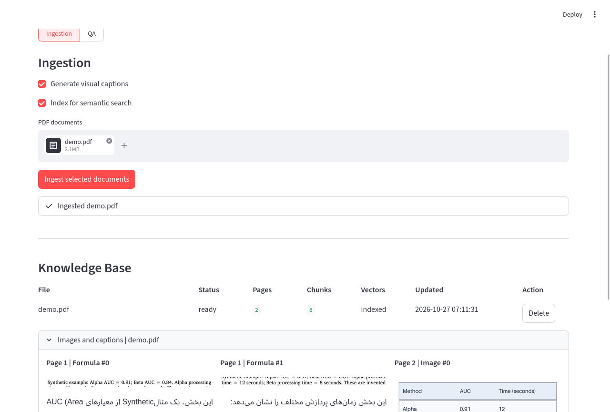
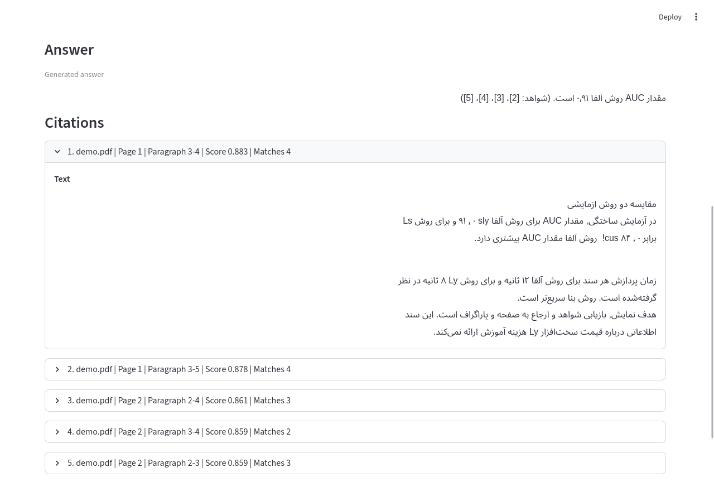

# Demonstration

Use the original synthetic PDF produced by `python -m examples.make_demo_pdf`. It includes Persian body text, English technical terms, and a raster table with invented values. It can be shared without copying either journal paper into screenshots.

[Watch the completed two-minute recording](assets/demo.webm). It shows actual ingestion, visual captions, BM25 QA, semantic QA, and retrieved evidence. The video includes processing waits; its footer labels playback speed. The original observed timeline was 120.16 seconds, presented in 120 seconds at approximately real time. [Recording metadata](../validation/demo-recording.json) records the capture and encoding details.





## Two-minute walkthrough

1. Open **Ingestion** and show the caption and semantic-index switches.
2. Upload `app_data/demo.pdf` and ingest it. Show progress and indexed status.
3. Open **QA**, select the demo document, and ask `مقدار AUC روش آلفا چقدر است؟` using BM25.
4. Show the generated-answer label, then expand the cited paragraph. The supplied value is 0.91.
5. Switch to semantic retrieval and ask the same question. Explain that retrieval scores are ranking signals, not calibrated confidence.
6. Show the visual-region gallery and its generated caption.

A recording should show the actual app. Do not present a mocked answer, invented benchmark result, or source excerpt as successful generated inference. Avoid displaying credentials, personal uploaded files, or the third-party evaluation PDFs.

The GPU smoke command provides a repeatable technical check before recording:

```bash
python -m scripts.gpu_smoke --output evaluation_runs/gpu-smoke.json
```

Runtime depends on the machine, model-loading state and OCR speed. Keep the original timing or label edited waiting periods in a published video. A short recording is a usability demonstration, not an answer-quality evaluation.
